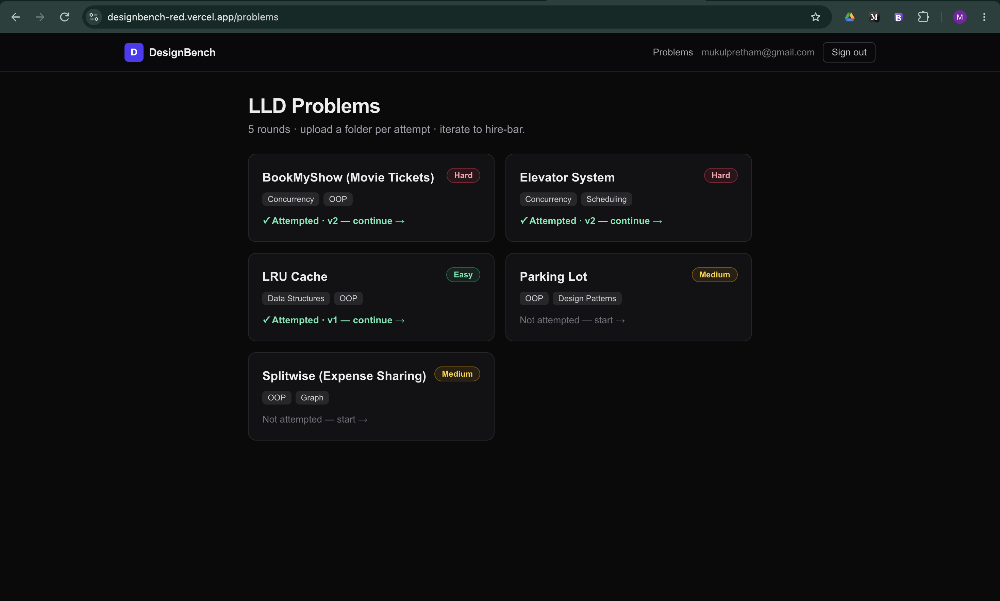
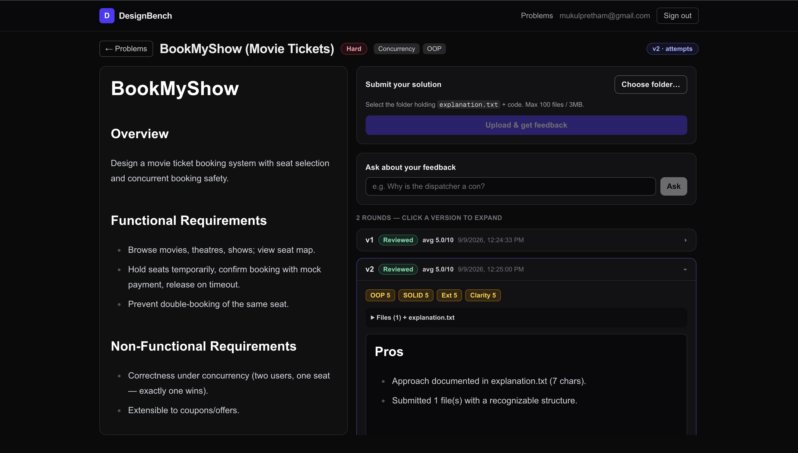
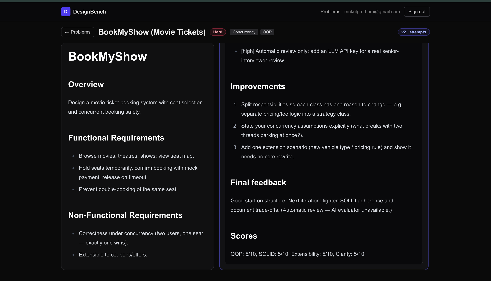
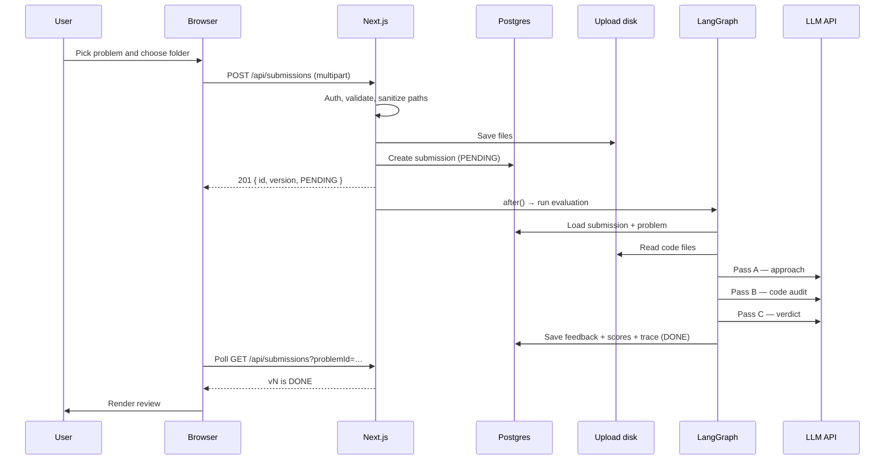
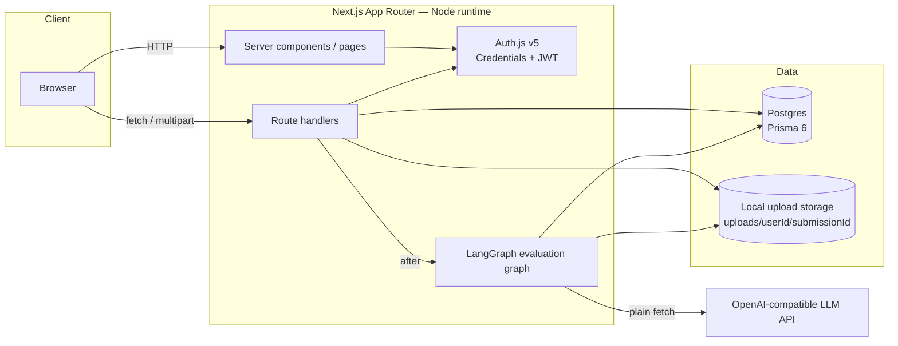
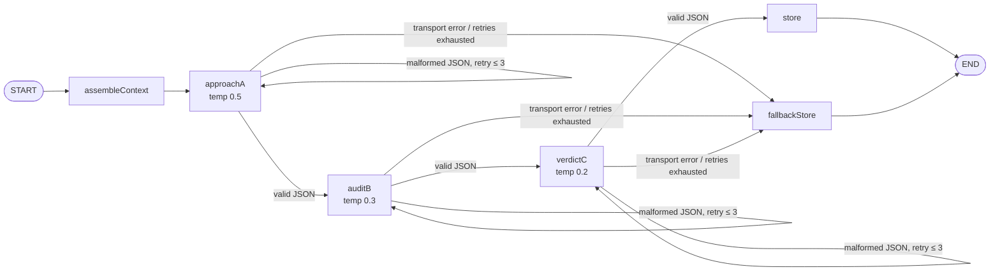
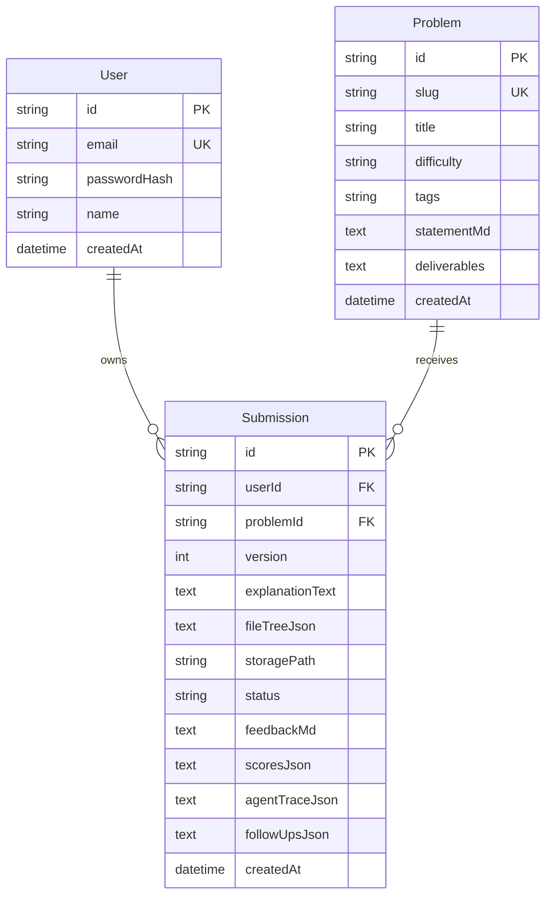

# DesignBench

**[Try now → designbench-red.vercel.app](https://designbench-red.vercel.app/)**

An AI senior-interviewer for Low-Level Design. Pick a classic LLD problem, upload your approach and code, and get a structured three-pass review — approach, code audit, and a hiring-style verdict. Every upload becomes a new version, so you can fix the blockers and be judged on whether you actually improved.

---

## Contents

- [Why DesignBench exists](#why-designbench-exists)
- [The problem](#the-problem)
- [The solution](#the-solution)
- [Features](#features)
- [How it works](#how-it-works)
- [Architecture](#architecture)
- [Tech stack](#tech-stack)
- [Getting started](#getting-started)
- [Environment variables](#environment-variables)
- [Deployment](#deployment)
- [Security and reliability](#security-and-reliability)
- [Limitations and roadmap](#limitations-and-roadmap)
- [AI usage report](#ai-usage-report)
- [Author](#author)

---

## Why DesignBench exists

Low-Level Design interviews are strange to prepare for.

There are plenty of problem statements online — design a parking lot, Splitwise, an elevator system, a movie-ticket booking flow. What is missing is the thing that actually matters in the interview: **a senior engineer who reads your design, questions your assumptions, checks whether your code matches your explanation, and tells you what a hiring panel would think.**

Most preparation tools optimise for algorithmic coding. LLD rounds are different. They test whether you can:

- break a vague problem into entities, responsibilities, and interfaces;
- choose patterns for a reason, not because a blog post used them;
- reason about concurrency, extensibility, and trade-offs;
- defend your design when someone pushes back;
- improve a weak design across iterations.

DesignBench was built to make that feedback loop repeatable. It is not a code generator and it is not a LeetCode clone. It is a practice interviewer that gives you a structured verdict, points at the files behind its criticisms, and remembers what you submitted last time.

---

## The problem

A typical LLD preparation loop looks like this:

1. Read a problem statement.
2. Write an `explanation.txt` and some classes.
3. Ask a friend, a mentor, or a general-purpose chatbot for feedback.
4. Get either “looks good” or a wall of generic advice.
5. Change something, but have no reliable way to know whether it got better.

There are three gaps in that loop:

**Feedback is scarce and inconsistent.** Not everyone has a senior engineer available to review design work. Different reviewers focus on different things, and casual feedback rarely follows a rubric.

**Most tools do not verify claims against code.** A design explanation can say “I used the Strategy pattern” while the code contains a single `if/else` chain. A useful reviewer has to check the claim, not just read it.

**One-shot feedback cannot measure improvement.** An LLD round is a conversation. The candidate explains, gets challenged, revises, and explains again. Without versions, there is no way to judge whether the second attempt actually addressed the first set of blockers.

Generic AI chat helps with brainstorming, but it tends to forget the previous attempt, praise structure it has not inspected, and produce advice that sounds specific without citing anything.

---

## The solution

DesignBench turns LLD review into a repeatable loop:

> **Explain → defend → audit → verdict → iterate**

The candidate uploads a folder containing `explanation.txt` plus source files. The platform creates a versioned submission and runs a three-pass review:

1. **Approach interview** — the reviewer reads only the explanation and probes the design: entities, pattern choices, credibility, gaps, and the questions the code should answer.
2. **Code audit** — the reviewer reads the actual files, cross-examines the approach against the implementation, verifies claims, and cites specific files for every criticism.
3. **Verdict** — the reviewer merges both passes into a hiring-style verdict, the top blockers, and scores for OOP, SOLID, extensibility, and clarity.

The result is stored as a version in a chat-like thread. The candidate can ask follow-up questions, fix the blockers, and upload again as `v2`, `v3`, and so on. The next review receives the previous verdict and a file-level diff, so it can judge improvement instead of starting from zero.

The design principles behind the product:

- **Approach first, code second.** The reviewer forms questions before seeing the implementation, which makes the code audit purposeful.
- **Evidence over claims.** If the explanation and the code disagree, the code wins.
- **Every criticism points somewhere.** The audit must cite files that were actually uploaded.
- **Honest failure is better than fake feedback.** If the model fails or no key is configured, the app returns a clearly labelled automatic review — never an invented verdict.
- **Upload should feel instant.** Evaluation runs after the HTTP response, while the client polls for the finished review.

How that differs from asking a general-purpose chatbot:

| General-purpose chat | DesignBench |
| --- | --- |
| One prompt, one answer | Three passes with separate jobs |
| Forgets the previous attempt | Stores a version thread and sends the previous verdict + file diff |
| Reviews the explanation | Cross-checks claims against the uploaded code |
| Generic advice | Severity-tagged cons with file citations and a score breakdown |
| Failure looks like a normal answer | Failure is labelled, logged, and rendered as an honest fallback |

---

## Features

### A small, focused problem library

Five classic LLD rounds are seeded out of the box: Parking Lot, Splitwise, Elevator System, BookMyShow, and LRU Cache. Each has a full brief, functional and non-functional requirements, constraints, difficulty, tags, and a “what to submit” checklist. The list page also shows whether you have attempted a problem and which version you reached.



*The problem library with difficulty, tags, and attempt state.*

### A split workspace built for iteration

The problem page keeps the brief visible on the left while the right side holds the uploader, the follow-up box, and the version thread. You can re-read the requirements without losing your place in the review.



*The workspace: problem statement, folder upload, follow-up box, and collapsible version history.*

### Versioned submissions

Every upload becomes a new version for that user and problem. Versions are ordered oldest to newest, and the latest one opens automatically. Older versions stay available so you can compare what changed.

Each version stores:

- the uploaded file tree;
- the `explanation.txt` text;
- the generated review;
- the score breakdown;
- the agent trace;
- the timestamp and status.

The oldest versions beyond the latest 20 are pruned automatically, including their files on disk.

### A scored, file-cited review

Each review is rendered as a stable markdown template:

- **Pros**
- **Cons**, tagged by severity and citing the relevant file
- **Improvements**, with the reason and an example
- **Top blockers**
- **Final feedback** with a single highest-leverage next step
- **Scores** for OOP, SOLID, Extensibility, and Clarity

Scores are colour-coded: green at 8+, amber at 5–7, red below 5.



*Each version opens into a scored review with actionable feedback.*

> The workspace and review screenshots were captured in fallback mode, where the app returns an honest automatic review instead of pretending an AI reviewed the code. With `LLM_API_KEY` configured, the same UI renders the full three-pass model review.

### A three-pass interview panel

The review is not a single prompt. It is a LangGraph state machine with three distinct jobs:

| Pass | What it sees | What it produces |
| --- | --- | --- |
| **A — Approach** | Problem statement + `explanation.txt` only | Entities, pattern choices, strengths, gaps, 3–5 questions the code must answer, approach score |
| **B — Code audit** | Problem + explanation + pass A’s questions + actual code + previous verdict and file diff | Claim verifications, pros, severity-tagged cons with file citations, improvements, code scores |
| **C — Verdict** | Pass A summary + pass B findings | Final hiring-style feedback, top three blockers, final scores |

Pass B is where the anti-hallucination guardrail matters: it may reference only files present in the provided tree, and it must explicitly say when the code contradicts the explanation. Pass C is instructed that code evidence beats approach claims.

### Ask follow-up questions

After a review, the “Ask about your feedback” box lets the candidate ask why a particular point was made. The answer is grounded in the stored interview trace — the gaps, cons, and verdict — rather than the whole uploaded codebase. Follow-up answers are currently ephemeral and are not persisted.

### Instant uploads, background evaluation

Uploading a folder should not leave the browser hanging for two minutes. The upload route validates and stores the files, creates the submission with `PENDING` status, returns `201` immediately, and runs the agent graph in Next.js `after()`.

The client polls the thread endpoint every three seconds until the status flips to `DONE`, with a three-minute timeout and a graceful “refresh to check” message. When the review lands, the version box expands automatically.

### Honest fallback mode

The app is usable without an LLM key. In that case it builds a clearly labelled automatic review from the submission metadata and returns 5/10 scores, with a high-severity con explaining that a real AI review needs a key. If a model call fails or returns malformed JSON after retries, the fallback review is annotated with the failing pass and the reason.

No fake verdicts. No silent failures.

### Authentication and protected workspace

Email/password signup and login are handled by Auth.js v5 with a JWT session. Passwords are hashed with bcrypt at cost 12. Pages redirect unauthenticated users to `/login`, and API routes return `401` rather than leaking data. Login, signup, and upload endpoints are rate-limited.

---

## How it works



The user journey in words:

1. **Sign up** or log in.
2. **Pick a problem** from the library.
3. **Choose a folder** on disk containing `explanation.txt` and code.
4. The server validates the folder, sanitizes every path, stores the files, and creates a pending version.
5. The browser polls while the review runs in the background.
6. The review appears as a new version in the thread.
7. The candidate asks follow-ups, fixes blockers, and uploads the next version.
8. The reviewer receives the previous verdict and a file-level diff, and judges improvement.

---

## Architecture

### System overview



There is no edge middleware. Authentication is enforced server-side: pages call `auth()` and redirect, while API routes return `401`. This keeps the edge bundle small and makes every protected path explicit.

### The evaluation graph



The graph uses LangGraph’s typed `Annotation.Root` state: submission id, assembled context, each pass result, attempt counters, failed pass, error, and per-pass latency. Only malformed model JSON is retried. Transport and API errors go straight to the fallback path, because retrying a bad key or a dead endpoint just wastes time.

The model call itself is a plain `fetch` to an OpenAI-compatible `/chat/completions` endpoint. LangGraph handles orchestration and retry routing; it does not own the HTTP client. This kept the integration small and made it easy to switch between Gemini’s OpenAI-compatible endpoint and any other provider.

Each pass requests JSON mode (`response_format: { type: "json_object" }`) with its own token budget — 1,000 for pass A, 2,200 for pass B, and 600 for pass C. The HTTP client times out after 90 seconds, so a stalled provider cannot hold the background task forever.

### Context assembly

The context is assembled once per evaluation and shared by all three passes:

| Input | Cap |
| --- | --- |
| `explanation.txt` | 8,000 characters |
| Code | 30,000 characters across up to 50 files |
| Previous version’s feedback | 1,000 characters |
| File diff vs previous version | File list only — no LLM cost |

Code files are read from disk in tree order and wrapped with `--- path ---` headers. If the total budget is exhausted, the remaining files are counted as omitted and the model is told how many were left out. `explanation.txt` is excluded from the code section because it is already supplied separately.

The diff compares the previous and current file trees by path and size. It adds, removes, and modifies filenames only — enough for the reviewer to see the shape of the iteration without paying to re-read unchanged files.

### Scoring and verdict bands

Each review produces four scores from 1–10:

- **OOP** — entities, responsibilities, encapsulation.
- **SOLID** — cohesion, coupling, dependency direction.
- **Extensibility** — how cleanly new requirements fit.
- **Clarity** — naming, structure, readability, explanation quality.

The verdict prompt uses a hiring-style bar:

| Score | Interpretation |
| --- | --- |
| **8–10** | Would pass a real LLD round |
| **5–7** | Fixable gaps; promising but not there yet |
| **1–4** | Needs rework |

The final feedback is deliberately short: a verdict plus the single highest-leverage next step. The top three blockers are listed separately so the candidate knows what to fix first.

### Data model



`Submission` has a unique constraint on `(userId, problemId, version)` and an index on `(userId, problemId)`. The chat thread is derived by querying submissions ordered by version — there is no separate message table. `followUpsJson` is reserved for future persistence; follow-up answers are currently ephemeral.

### Storage model

The database stores metadata, explanations, file trees, feedback, scores, and agent traces. The uploaded bytes live on local disk:

```text
uploads/
└── {userId}/
    └── {submissionId}/
        ├── explanation.txt
        ├── src/
        │   ├── ParkingLot.java
        │   └── ...
        └── ...
```

`storagePath` is stored as `{userId}/{submissionId}`. Paths are preserved relative to the selected folder, with the shared top-level folder prefix stripped when needed (`TestBench/src/...` becomes `src/...`).

### API surface

| Method | Route | Purpose |
| --- | --- | --- |
| `POST` | `/api/auth/signup` | Create an account (Zod-validated, bcrypt-12) |
| `GET/POST` | `/api/auth/[...nextauth]` | Auth.js session and credentials handlers |
| `GET` | `/api/problems` | List problems with submission counts |
| `GET` | `/api/problems/[slug]` | Fetch one problem |
| `GET` | `/api/submissions?problemId=` | Read the user’s version thread for a problem |
| `POST` | `/api/submissions` | Validate, store, and queue a folder submission |
| `POST` | `/api/submissions/[id]/ask` | Ask a follow-up about a stored review |
| `GET` | `/api/health` | Lightweight health check |

### Project structure

```text
app/
├── page.tsx                     Landing page
├── login/                       Login page
├── signup/                      Signup page
├── problems/                    Problem library and split-pane solve page
└── api/
    ├── auth/                    Signup + Auth.js handlers
    ├── problems/                Problem list and detail APIs
    ├── submissions/             Upload, thread, and ask APIs
    └── health/                  Health check

components/
├── ChatThread.tsx               Version boxes, scores, file list, review markdown
├── FolderUploader.tsx           Folder picker, client validation, polling
├── AskBox.tsx                   Follow-up question UI
├── ProblemPane.tsx              Problem statement renderer
├── Markdown.tsx                 Shared GitHub-style markdown renderer
├── Navbar.tsx                   Session-aware navigation
├── LoginForm.tsx / SignupForm.tsx
└── DifficultyBadge.tsx

lib/
├── auth.ts                      Auth.js credentials provider + JWT callbacks
├── db.ts                        Prisma singleton
├── storage.ts                   Path sanitization, file writes, deletion
├── ratelimit.ts                 In-memory sliding-window limiter
├── agent.ts                     Evaluation entry point + follow-up answers
└── agent/
    ├── graph.ts                 LangGraph state machine and nodes
    ├── context.ts               Context assembly, caps, file diff
    ├── passes.ts                Prompt contracts and strict JSON parsing
    ├── llm.ts                   OpenAI-compatible fetch client
    └── render.ts                Deterministic review markdown

prisma/
├── schema.prisma                User, Problem, Submission
└── seed.ts                      Five seeded LLD problems
```

### Key technical decisions

- **Next.js App Router with server components.** Pages fetch directly from Prisma where possible; route handlers exist for upload, polling, and auth. One deployable unit, no separate API service.
- **Prisma 6, pinned deliberately.** Prisma 8’s platform CLI changed the `generate` / `db push` workflow in a way that did not fit a single Neon Postgres database. Pinning v6 kept the classic workflow and avoided surprise upgrades.
- **Auth.js v5 Credentials + JWT.** A small, self-contained auth surface for a practice app: bcrypt hashes, JWT session cookies, and server-side checks in every protected page and route.
- **LangGraph for orchestration, plain `fetch` for the model.** The graph provides typed state and conditional retry edges. The model client stays a boring HTTP call, which makes provider swaps and error handling predictable.
- **Deterministic renderer.** The model returns JSON; `render.ts` turns it into a stable markdown template. The UI does not depend on the model remembering formatting instructions.
- **Database metadata + local file bytes.** Postgres handles relational queries and versioning; disk handles source files without bloating rows. The two are joined by `storagePath`.
- **Background evaluation.** `after()` keeps the upload request fast and avoids a stuck spinner. Polling was chosen over server-sent events because the job is short, the existing thread endpoint already returns status, and polling degrades gracefully past the timeout.
- **Approach-first prompting.** Pass A never sees code, so its questions are not anchored by the implementation. Pass B then has a concrete checklist instead of vaguely “reviewing the code”.

---

## Tech stack

| Layer | Choice |
| --- | --- |
| Framework | Next.js 16 (App Router, Node runtime) |
| UI | React 19, Tailwind CSS 4, `@tailwindcss/typography` |
| Language | TypeScript 5 |
| Auth | Auth.js v5 beta (Credentials, JWT), bcryptjs |
| Database | PostgreSQL (Neon-compatible) |
| ORM | Prisma 6 |
| Agent orchestration | LangGraph 1.x (`StateGraph`) |
| LLM access | OpenAI-compatible Chat Completions via `fetch` |
| Validation | Zod 4 |
| Markdown | react-markdown |
| Seeding | `tsx` + Prisma |

---

## Getting started

### Prerequisites

- Node.js 20+
- A PostgreSQL database (local Postgres or a Neon database)
- Optional: an API key for an OpenAI-compatible LLM endpoint

### Run locally

```bash
npm install
cp .env.example .env        # fill in DATABASE_URL, NEXTAUTH_SECRET, and optionally LLM_*
npx prisma db push
npx tsx prisma/seed.ts      # seeds the five LLD problems
npm run dev                 # http://localhost:3000
```

Build check:

```bash
npm run build
```

### What happens without an LLM key?

The app still works. Uploads are stored and reviewed with the honest automatic template, and the UI clearly labels the review as automatic. Add `LLM_API_KEY` to enable the three-pass panel.

### Troubleshooting

- **Neon connection timeouts (`P2024`).** If you use a pooled Neon URL, append `&pgbouncer=true&connection_limit=5`. The app opens short-lived queries and polls every three seconds, so a small pool is usually enough.
- **LLM 404s.** Provider model names change. Probe the endpoint with `curl` rather than trusting an old model name. Also check `LLM_BASE_URL` for a trailing slash — the client strips trailing slashes, but a malformed path such as `/openai//chat/completions` will still fail.
- **Uploads fail with a read-only filesystem.** `UPLOAD_DIR` must be writable. This is fine locally; on serverless platforms, use persistent object storage instead (see [Deployment](#deployment)).
- **Review stuck on “Evaluating…”.** The client polls for three minutes. Check the server logs for the background evaluation error; the submission may have fallen back or the background task may have been cut short.

---

## Environment variables

| Variable | Required | Notes |
| --- | --- | --- |
| `DATABASE_URL` | Yes | PostgreSQL connection string. For Neon poolers, append `&pgbouncer=true&connection_limit=5` |
| `NEXTAUTH_SECRET` | Yes | Any random string. Required for JWT session signing |
| `NEXTAUTH_URL` | Local | `http://localhost:3000` in development; your public URL in production |
| `LLM_API_KEY` | No | Without it, reviews use the automatic fallback template |
| `LLM_MODEL` | No | Model name for the OpenAI-compatible endpoint; defaults to `gpt-4o-mini` |
| `LLM_BASE_URL` | No | Base URL; defaults to `https://api.openai.com/v1` |
| `UPLOAD_DIR` | No | Default `./uploads`; must be writable |

---

## Deployment

The public demo is deployed on Vercel with a Neon Postgres database:

**https://designbench-red.vercel.app/**

To deploy your own:

1. Push the repository to GitHub.
2. Import it into Vercel.
3. Add `DATABASE_URL`, `NEXTAUTH_SECRET`, `NEXTAUTH_URL`, and optionally `LLM_*` in the project settings.
4. Run `npx prisma db push` and `npx tsx prisma/seed.ts` against the production database.
5. Deploy.

> **Serverless storage note:** the current storage layer writes uploaded files to `UPLOAD_DIR` on local disk. That works well for local development and a single long-running server, but Vercel’s filesystem is ephemeral and not shared across invocations. For a production deployment, swap `lib/storage.ts` for S3, R2, or another object store and keep the same `storagePath` metadata contract.

The screenshots in this README show the fallback review mode. To see the full three-pass panel, configure `LLM_API_KEY` and upload a submission.

---

## Security and reliability

- **Password hashing:** bcrypt at cost 12; passwords are never stored in plain text.
- **Session handling:** Auth.js JWT sessions; `auth()` is checked in protected pages and API routes.
- **Ownership checks:** submission reads and follow-up questions are scoped to the authenticated user.
- **Path traversal protection:** uploaded relative paths are normalized, `..` segments are rejected, and every destination is checked to remain inside the submission directory.
- **Upload allowlist:** only source/text extensions are accepted; `node_modules`, `.git`, `__pycache__`, `.next`, `dist`, and `build` directories are dropped.
- **Size limits:** 100 files, 3 MB total, 200 KB per file, with a 20,000-character explanation stored in the database.
- **Rate limiting:** login, signup, and upload are limited to 10 requests per minute per key (in-memory; resets on restart).
- **No code execution:** submissions are read as text only. The reviewer never runs uploaded code.
- **No fake AI output:** missing keys, transport failures, and malformed model responses produce an explicitly labelled fallback review.
- **Secrets stay server-side:** the LLM key is read from the environment and is never sent to the browser.

---

## Limitations and roadmap

Current limitations, stated honestly:

- **Static review only.** The reviewer reads code; it does not compile it, run tests, or inspect runtime behaviour.
- **Local disk storage.** Great locally, not durable on serverless. Object storage is the next infrastructure step.
- **Ephemeral follow-ups.** Ask answers are not persisted; refreshing loses them.
- **Free-tier latency.** A full three-pass review can take one to two minutes depending on the provider.
- **Folder upload only.** No zip upload or GitHub import yet.
- **In-memory rate limits.** They reset on restart and are per-process, not distributed.
- **Single-reviewer model.** One model plays all three passes; there is no multi-model panel yet.

Roadmap ideas:

- S3/R2 storage with signed upload URLs.
- Streaming review progress instead of polling.
- A code-execution sandbox for tests and runtime checks.
- More problems, including machine-coding variants.
- Class-diagram and sequence-diagram uploads.
- A diff-aware review that comments on changed files, not just the whole tree.
- An evaluation harness built on `agentTraceJson` to measure review quality across prompts and models.
- Persisted follow-up threads per version.

---

## AI usage report

Tools used: Gemini (free tier, via API + web chat), ChatGPT, Muse Spark (in-editor agent).

How I worked: AI drafted options and boilerplate; I decided the architecture, verified every claim by running the app, and rejected suggestions that did not fit the constraints.

### 1. Prisma version choice — rejected AI’s default, verified manually

The AI-generated scaffold installed Prisma 8, whose CLI has no `generate` / `db push` (they moved under platform commands). The assistant initially kept trying v8 commands. I rejected that path: I checked `prisma --help` output myself, saw the CLI surface had changed, and downgraded to pinned Prisma 6, which restored the classic workflow.

Why: the v8 platform model (projects, branches, cloud coupling) was wrong for a single Postgres on Neon. Lesson applied: pin exact versions (`-E`) for fast-moving ORM/agent libraries.

### 2. Neon pooler + Prisma connection exhaustion — accepted with modification

After load testing I hit `P2024: timed out fetching a connection` (pool limit 17). The AI diagnosis — the pooler endpoint needs `pgbouncer=true`, and the app opens a client per HMR instance plus polling — was correct, and I accepted the fix, but I modified the numbers: AI suggested `connection_limit=15`; I set `5` because the pooler is shared and the app’s queries are short-lived. I also eased client polling from 2s to 3s on my own judgement to reduce churn. Verified with six rapid sequential page loads, all 200.

### 3. LangGraph adoption — accepted the shape, rejected the machinery

AI proposed the three-pass interviewer (approach → code audit → verdict), and I accepted the *architecture*, but rejected the first implementation sketch that pulled in LangChain chat models (`ChatOpenAI` + structured-output helpers). Reason: our Gemini free-tier key was already proven working over plain `fetch` to the OpenAI-compatible endpoint, and swapping model layers would have meant re-verifying auth, JSON mode, and error shapes. So: LangGraph `StateGraph` for orchestration (typed state, conditional retry edges), plain fetch inside nodes. State machine where it pays, boring HTTP where it doesn’t.

### 4. Gemini model selection — AI suggestion was stale, corrected by experiment

The assistant’s first recommendation (`gemini-2.0-flash`) 404’d. Instead of trusting docs from memory, I probed the API directly with `curl` across candidate model names and found the 2.x line retired; `gemini-3.5-flash-lite` returned 200. I also isolated a second 404 to a double slash in our constructed URL (`openai/` + `/chat/...`) by testing payloads field-by-field, then fixed it in `.env` and added a trailing-slash guard in code. Accepted: nothing on authority; every endpoint claim earned via `curl`.

### 5. Upload UX (blocking eval → background + poll) — my call, AI implemented

Users reported the Upload button “hanging”. My decision: evaluation must leave the request path (respond `201 PENDING` immediately, run the graph in `after()`, client polls). I rejected the AI’s alternative (server-sent events) as over-engineering for a 1–2 minute job — polling the existing thread endpoint needed no new protocol and degrades gracefully (“refresh to check” past timeout). AI did the refactor; I verified PENDING-then-DONE timing across five live uploads before keeping it.

### Standing rules I kept throughout

- No AI claim merged without a live run (every phase ended in `npm run build` + `curl` E2E).
- Secrets never pasted into prompts beyond the local `.env`; the committed repo contains no keys.
- When docs and behavior disagreed (Prisma 8 CLI, Gemini model names), behavior won.

---

## Author

Built by **Mukul Pretham**.

If you are reviewing this as a project submission, the AI usage report above documents where AI helped, what was rejected, and how each claim was verified.
